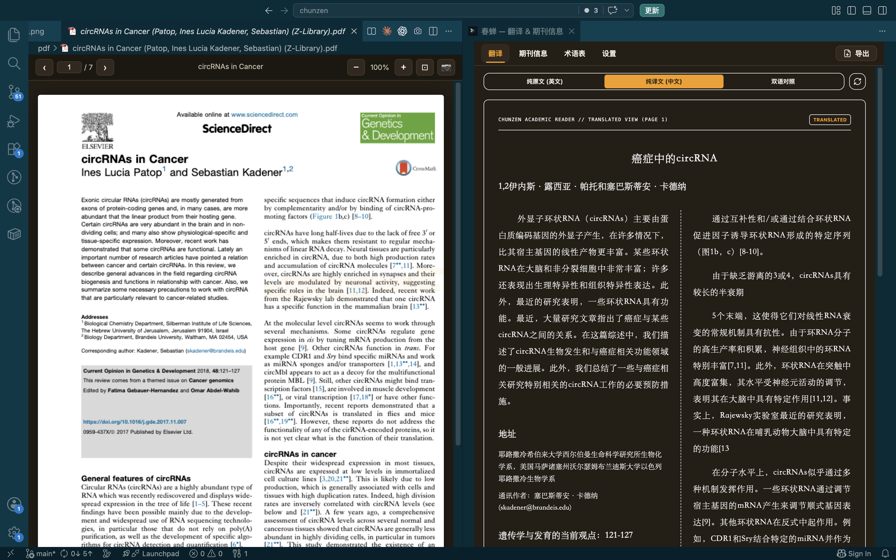
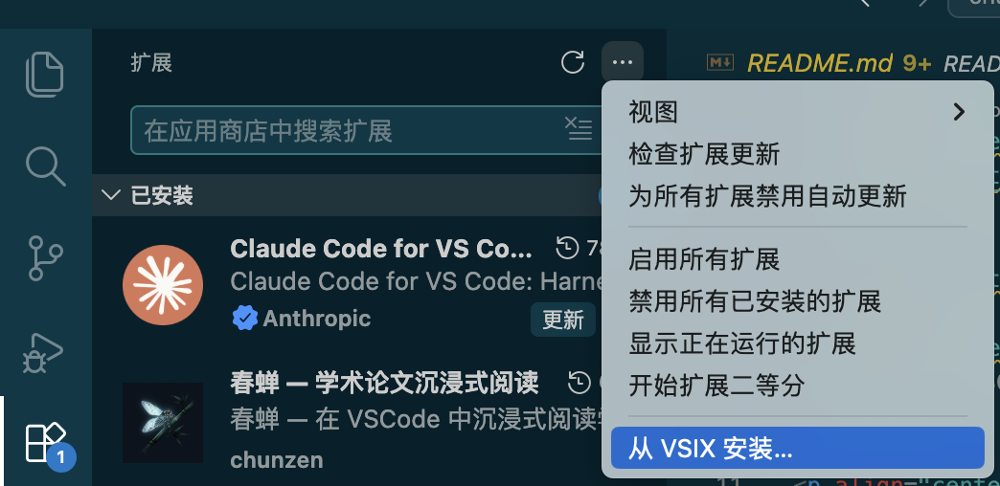

  

<h1 align="center">春蝉 ChunZen</h1>

  <strong>在 VSCode 中沉浸式阅读学术 PDF，支持整页双语对照翻译、选中文字 AI 释义、期刊信息查询、术语表管理，让文献阅读更高效。</strong>

  
  

  

## 功能特性

### 实时翻译

- **整页翻译** — 在 PDF 中翻页即可同步提取当前页排版，点击「翻译整页」或开启自动翻译后，右侧面板支持纯原文 / 纯译文 / 双语对照三种视图
- **右侧选中文字 AI 释义** — 在右侧原文/对照区选中单词、短语或句子，弹出菜单可 **AI 解释**（先给译文，再给含义与背景解释）、划线高亮、写想法、复制；选中单词或短语（≤ 6 词）时可在释义抽屉内直接 **记术语**。未配置大模型时自动降级为机器翻译
- **多引擎自动切换与独立开关** — 按拖拽排序后的优先级依次尝试，首个成功即返回，且支持随时独立启用/停用某个引擎而不丢失密钥：
  - 百度翻译
  - AI 翻译（OpenAI 兼容接口，支持多平台配置数组并存）
  - DeepL（免费/专业版；未配置时在设置中折叠，已有账号可展开配置）
  - 自定义 HTTP 接口
- **翻译缓存** — LRU 内存缓存 + 磁盘持久化，缓存条数上限（50 ~ 5000）可在设置中调节
- **翻译历史** — 自动记录翻译结果，支持导出为 Markdown / 双语对照文档

### 期刊信息查询

- **自动提取 DOI/ISSN** — 从 PDF 首页文本中正则匹配
- **双数据源** — 科研通 (AbleSci) / LetPub，自动故障转移
- **期刊指标** — 影响因子、中科院分区、JCR 分区、预警状态
- **深度信息** — 自引率、审稿周期、录用率、出版社、投稿链接
- **论文元数据** — 发表年份、第一作者、通讯作者、所属机构

### 术语表

- **60+ 预置学术术语** — 覆盖 AI/CS、生物医学、化学、物理、通用学术 5 大类
- **自定义添加** — 手动添加术语对照，支持分类管理
- **文件导入** — 支持 CSV/TSV/TXT/JSON 格式批量导入
- **翻译时自动匹配** — LLM 引擎注入系统提示词，非 LLM 引擎后处理替换

### PDF 阅读体验

- **自定义 PDF 渲染器** — 基于 PDF.js 的 Canvas 渲染 + 文字层叠加
- **智能段落解析** — 多栏检测、标题识别、参考文献/表格/图注结构化识别
- **水平分隔线检测** — 从 PDF 矢量路径中提取，作为段落边界
- **噪声过滤** — 自动跳过页眉页脚、水印、作者机构信息
- **跨页重复文本检测** — 识别并隐藏跨页重复的边缘文本
- **段落悬停双向高亮** — 鼠标悬停在 PDF 段落或右侧对照面板上，双向同步高亮，方便中英文逐段/逐句对比阅读
- **表格图片回退** — 检测表格区域并截图为图片，避免乱码翻译
- **图片区域截图** — 工具栏截图按钮，手动截图当前页面的图注区域

### 侧边栏与快捷切回

- **翻译标签页** — 纯原文、纯译文、双语对照，支持整页翻译与导出
- **期刊标签页** — 期刊基本信息、深度指标、论文元数据，可折叠展示
- **术语标签页** — 术语列表、搜索过滤、分类标签、添加/编辑/删除与批量导入
- **设置标签页** — 翻译引擎（拖拽排序 + 独立开关）、阅读与外观（即时生效）、期刊查询与数据源、高级版面解析模型、系统维护与缓存
- **一键找回原文与译文** — 左侧 PDF 工具栏右上角提供「打开右侧翻译面板」按钮；VS Code 底部状态栏常驻春蝉图标，点击即可将原文 PDF 与译文面板一键切回前台

### 主题支持

- **暖色深色主题** — 深褐暖色调，长时间阅读更舒适
- **暖色浅色主题** — 奶油纸张色调，自然光环境下友好
- **自适应切换** — 跟随 VSCode 深色/浅色主题自动切换

## 快速开始

1. 在项目的 **Releases** 页面下载最新打包的 `chunzen-*.vsix` 插件文件。
2. 打开 VS Code，进入扩展视图（`Cmd+Shift+X` 或 `Ctrl+Shift+X`），点击右上角的 `...` 更多操作菜单，选择 **从 VSIX 安装... (Install from VSIX...)**，导入下载好的 `.vsix` 文件完成安装。

   

     
   

3. 用 VS Code 打开任意 `.pdf` 文件，春蝉会自动接管渲染，并在右侧同步展示排版后的原文视图。
4. 在右侧 **设置** 中配置翻译引擎的 API Key，回到 **翻译** 标签页点击 **翻译整页**（或开启自动翻译），即可生成译文与双语对照；在右侧划选词句可使用 **AI 解释**、高亮与笔记功能。

## 翻译引擎配置

### AI 翻译（OpenAI 兼容接口）

支持任何遵循 OpenAI `chat/completions` 格式的模型服务，并采用**多平台配置数组**管理：

- **多平台并存、互不覆盖**：可随时添加任意多个平台或中转站配置（支持自定义名称、独立密钥、上移/下移调整优先级、单条启用/停用）；
- **预设快速添加**：「自定义 / 中转站」排在第一位，内置 DeepSeek 官方、智谱 BigModel、硅基流动 SiliconFlow 模板；
- **模型拉取与筛选**：每条配置在「模型名称」输入框旁均提供 **拉取模型** 按钮，支持关键词筛选并点选填入；
- **AI 学术释义专用模型**：支持单独指定某条配置用于划词「AI 解释」（默认跟随翻译第 1 顺位）；
- **单条测试连接**：每张配置卡片内可独立点击「测试此配置」，失败时会给出实际请求地址、状态码与可执行排查建议。

| 配置字段 | 说明 | 默认值 |
|----------|------|--------|
| Base URL | API 端点地址，**必填**（API Key 只会发往此地址）。根地址、带 `/v1` 的地址、完整 `/chat/completions` 地址都能识别 | 无 |
| API Key | 对应平台的密钥 | 无 |
| 模型名称 | 使用的模型，**必填**；可点输入框旁的「拉取模型」从接口返回的模型里搜索点选 | 无 |
| 请求超时 | 高级选项，单次请求超时（毫秒） | 60000 |
| 系统提示词 | 高级选项，翻译风格指令（留空使用默认学术翻译提示词） | 学术翻译专家提示词 |

#### 网络不通时的排查

所有网络请求都走 `src/utils/fetch.ts` 的 `customFetch`，它会：

- 继承 VS Code 的 `http.proxy` 设置或 `HTTPS_PROXY` / `HTTP_PROXY` 环境变量；
- 当前链路超时或拒绝连接时自动换另一条链路（代理 ↔ 直连、原生 `fetch` ↔ `node-fetch`）再试一次；
- 关闭 Node 20+ 的 `autoSelectFamily`（Happy Eyeballs）。部分服务商的域名有多条 A 记录，该特性会让请求一直等到整体超时，表现为 `fetch failed`，而 `curl` 正常；
- 把 `ETIMEDOUT` / `ENOTFOUND` / 自签名证书等底层错误翻译成可操作的中文提示，不再把裸 `fetch failed` 抛给界面。

#### 常用服务商推荐与一键预设：

- **DeepSeek 官方开放平台**
  - Base URL: `https://api.deepseek.com`
  - 推荐模型: `deepseek-flash`（即 V4.1-Flash，版本号 `DeepSeek-V4.1-Flash-1017`；另有 `deepseek-v4-pro`）
  - 注意：旧的 `deepseek-chat` / `deepseek-reasoner` 已下线，填了会报模型不存在
  - API Key: 在 [DeepSeek 开放平台](https://platform.deepseek.com/api_keys) 控制台获取。

- **智谱 GLM (BigModel)**
  - Base URL: `https://open.bigmodel.cn/api/paas/v4`
  - 推荐模型: `glm-4-flash`（另有 `glm-4.5`、`glm-5`、`glm-5.3-flash` 等，以控制台为准；点“拉取模型列表”可看到全部 12 个）
  - **新用户福利**：通过 [专属邀请链接](https://www.bigmodel.cn/invite?icode=PJ048yz3Fl63Urk70glapiUjscDI85ErLfUl7XNb00w%3D)（邀请码：`PJ048yz3Fl63Urk70glapiUjscDI85ErLfUl7XNb00w=`）注册，免费领取 2000 万 Tokens 大礼包。

- **硅基流动 (SiliconFlow)**
  - Base URL: `https://api.siliconflow.cn/v1`
  - 推荐模型: `zai-org/GLM-5.3-Flash`（模型名需带命名空间前缀，如 `Qwen/Qwen2.5-7B-Instruct`、
    `zai-org/GLM-5.3`；注意与智谱直连的 `glm-4-flash` 不同）
  - **新用户福利**：通过 [专属邀请链接](https://cloud.siliconflow.cn/i/CZLEQUh5)（邀请码：`CZLEQUh5`）注册，免费获赠 2000 万 Tokens（14 元算力额度）。

- **自定义 / 中转站**
  - Base URL 与模型名按你购买的服务说明填写，例如中转站常见的
    `https://your-relay.example.com/v1` + `gpt-4o-mini`
  - 三种填法都能识别：根地址、带 `/v1` 的地址、完整 `/chat/completions` 地址
  - 填好后可点“测试连接”，失败时结果卡会给出实际请求的地址与原因

### 百度翻译

需要在 [百度翻译开放平台](https://fanyi-api.baidu.com) 注册获取 App ID 和密钥。

### DeepL

在 [DeepL](https://www.deepl.com/pro-api) 获取 API Key，支持免费版和专业版。

## 命令面板

| 命令 | 说明 |
|------|------|
| `春蝉：打开翻译面板` | 打开或切回右侧翻译与期刊信息面板 |
| `春蝉：一键切回原文与译文` | 将当前 PDF 原文与右侧译文面板一起切回前台 |
| `春蝉：用春蝉 PDF 阅读器打开` | 使用春蝉打开指定 PDF 文件 |
| `春蝉：截图当前页图像区域` | 手动截图当前页面的图片区域，保存为 PNG |
| `春蝉：清除翻译缓存` | 清空本地翻译缓存 |
| `春蝉：配置翻译引擎` | 查看已配置的翻译引擎或跳转设置 |

## 键盘快捷键与阅读手势

| 按键 / 动作 | 功能 |
|------|------|
| `PageDown` / `Space` (触底) / `↓` (触底) | 翻至下一页 |
| `PageUp` / `Shift+Space` (触顶) / `↑` (触顶) | 翻至上一页 |
| `→` (触右边缘) | 翻至下一页 |
| `←` (触左边缘) | 翻至上一页 |
| 滚轮向下滚动 (触底) | 翻至下一页（带 800ms 防连刷冷却机制） |
| 滚轮向上滚动 (触顶) | 翻至上一页（带 800ms 防连刷冷却机制） |
| `+` / `=` | 放大页面 |
| `-` | 缩小页面 |

## 技术栈

- **React** + **Zustand** — 右侧翻译、期刊、术语与设置面板 UI
- **PDF.js 3.11** — PDF 渲染引擎（随扩展打包，无需联网加载）
- **Tailwind CSS** — 样式系统
- **Webpack** — 多目标构建（extension / panel / pdfViewer）

## 支持作者

如果春蝉对您的科研工作有帮助，欢迎请作者喝杯咖啡

  
  &nbsp;&nbsp;&nbsp;&nbsp;
  

  <em>支付宝</em>&nbsp;&nbsp;&nbsp;&nbsp;&nbsp;&nbsp;&nbsp;&nbsp;&nbsp;&nbsp;&nbsp;&nbsp;&nbsp;&nbsp;&nbsp;&nbsp;&nbsp;&nbsp;&nbsp;&nbsp;&nbsp;&nbsp;<em>微信</em>

## 反馈与贡献

- 问题反馈：[GitHub Issues](https://github.com/itcuihao/chunzen/issues)
- 功能建议：欢迎提交 Issue 讨论

## 许可证

MIT License
